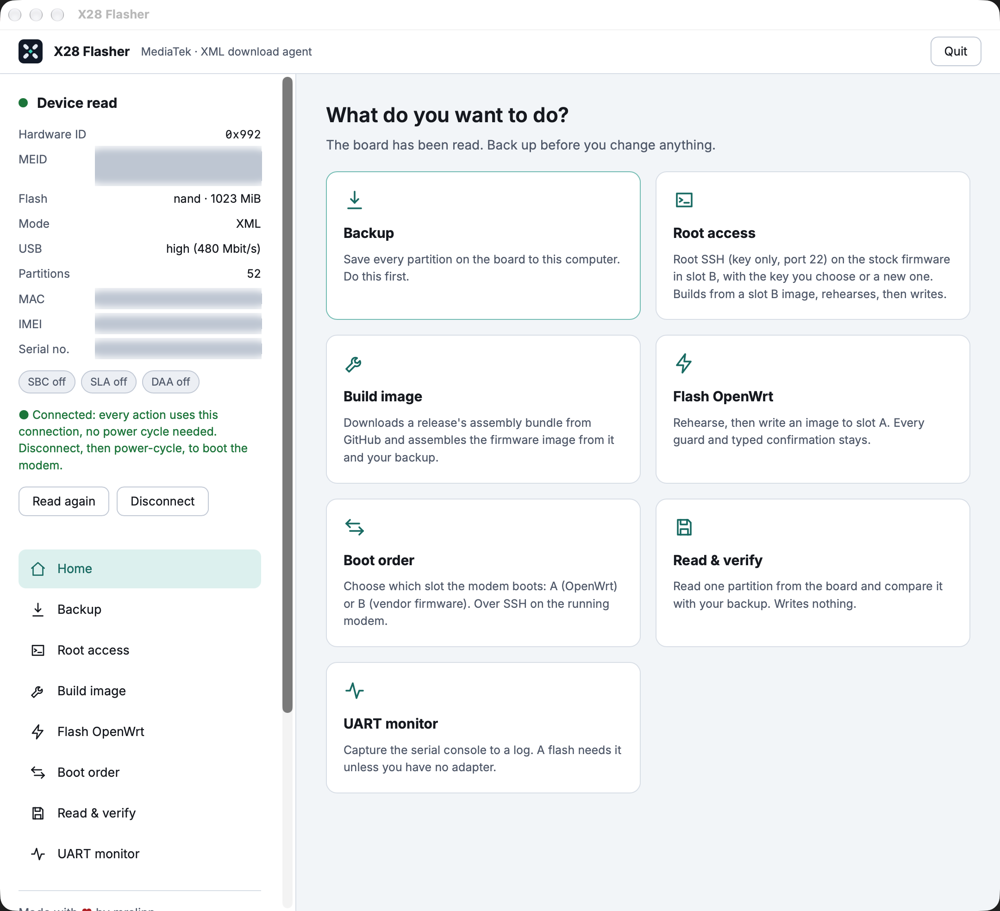

# X28 Flasher

Back up and flash your **ZLT X28 5G modem (MediaTek MT6890 / T750)** from a desktop app.

[Download](https://github.com/mralinp/x28-flasher/releases) · [Quick start](#quick-start) · [Full guide](docs/USAGE.md) · [Contribute](CONTRIBUTING.md)

> [!WARNING]
> Flashing can leave your modem unable to boot. **Make a verified backup and keep a second copy on another disk before writing.**
> Keep power and USB connected until the operation finishes. Stop or closing the app cannot undo a write.
> A UART adapter is recommended for diagnosing boot problems. Not affiliated with ZLT, Tozed, MediaTek or Quectel.

## Install

Download the package for your computer from **[Releases](https://github.com/mralinp/x28-flasher/releases)**.
Each supported platform has its own desktop window.

| Your computer | Download | Install and open |
|---|---|---|
| Windows 10 (1809+) / 11, x64 | `X28-Flasher-windows-x64-setup.exe` | Run setup, then open **X28 Flasher** from Start. |
| macOS, Apple silicon | `X28-Flasher-macos-arm64.dmg` | Drag the app to Applications. If blocked, use **System Settings → Privacy & Security → Open Anyway**. |
| Linux x86_64, Debian/Ubuntu-compatible | `X28-Flasher-linux-x86_64.deb` | Run `sudo apt install ./X28-Flasher-linux-x86_64.deb`, then open **X28 Flasher** from the menu. |
| Arch Linux, x86_64 | `X28-Flasher-archlinux-x86_64.pkg.tar.zst` | Install the dependencies with `sudo pacman -S --needed gtk3 hicolor-icon-theme libusb openssh python python-gobject webkit2gtk-4.1`, then run `sudo pacman -U ./X28-Flasher-archlinux-x86_64.pkg.tar.zst`. |

No cloning, pip setup or separate download agent is needed. The modem tools and `DA_BR.bin` are bundled.

- **macOS:** the bundle is ad-hoc signed, not Apple-notarized, so Gatekeeper may require **Open Anyway**. A “damaged” message is a separate issue—see [troubleshooting](docs/USAGE.md#troubleshooting).
- **Windows:** setup installs WebView2 if missing (internet required). The modem's download interface may also need a compatible WinUSB driver.
- **Linux:** The Debian package declares GTK/WebKitGTK 4.1 and OpenSSH dependencies. The Arch package declares GTK3, WebKitGTK 4.1, PyGObject, libusb and OpenSSH; both include the native desktop launcher.
- **Docker is only needed** for **Build from my backup** and **Root access**. Downloading and flashing a signed image needs no Docker.
- **Boot order** needs root SSH access to the running modem and an OpenSSH client on your computer. See the [full guide](docs/USAGE.md#boot-order).

## Quick start

You need the X28, its power supply, a USB data cable, and enough disk space for a full backup.

1. **Connect device.** Connect USB and follow the app's power-off/wait/power-on prompts. The device panel shows the stored boot slot.
2. **Backup.** Choose a writable folder (for example, under Documents), let verification finish, then copy the backup to another disk. Keep this unit's backup for recovery.
3. **Get an image.** Download a signed firmware image. Stable releases are shown by default; tick **Include beta releases** if you want pre-releases too.
4. **Choose the image and write slot.** In **Flash OpenWrt**, select **Built / downloaded image** or **Rootfs from a verified backup**, then choose target **A or B**. For a backup source, select saved `rootfs_a` or `rootfs_b` independently of the target. Writing **does not change boot order**.
5. **Flash or restore.** For a built/downloaded image, rehearsal is optional; turn **Rehearsal off for the real write**. A backup source directly restores the saved rootfs. Accept the checklist, type the exact phrase requested, and wait for read-back verification.
6. **Boot the modem.** Disconnect the USB session, then power-cycle when ready. If you wrote the other slot, you must change **Boot order** separately using root SSH access.

**Going back to vendor firmware?** Choose this unit's original vendor backup as the rootfs source. This restores only the selected rootfs and its saved settings—not the whole device. See [backup restore](docs/USAGE.md#restore-a-backup-rootfs).

**Root access is optional**, not a prerequisite for a USB flash. If you need SSH on stock firmware to change boot order, prepare it before flashing; see the [manual](docs/USAGE.md#root-access).

If a step fails, keep the run folder and logs. **Do not blindly retry a write, switch slots or reboot after a stopped write.**
Use the [full guide and recovery references](docs/USAGE.md#troubleshooting).

## Help and contribute

- [Full usage guide](docs/USAGE.md): each action, boot order, logs and troubleshooting.
- [Contributing guide](CONTRIBUTING.md): source setup, tests, builds and pull requests.
- [Report a problem](https://github.com/mralinp/x28-flasher/issues): include the app version, OS, failed step and error; redact device identifiers and secrets.
- [Firmware project](https://github.com/mralinp/zlt-x28-openwrt): OpenWrt images and recovery research.

## Support

Made with ❤️ by mralinp. Stars and contributions are welcome.
Donations on any EVM chain: `0x6743d8fe71f18b3101f3086e8d9f8d272d0f7618`.

## License

See [LICENSE](LICENSE). Bundled third-party components retain their own license terms.

Native-image hotfix: preserve regular `/lib/upgrade/keep.d/` backup lists during staging and management integration; enable `x28-telephony` at boot when its init script is installed. Upgrade hooks remain restricted to the reviewed implementations.
