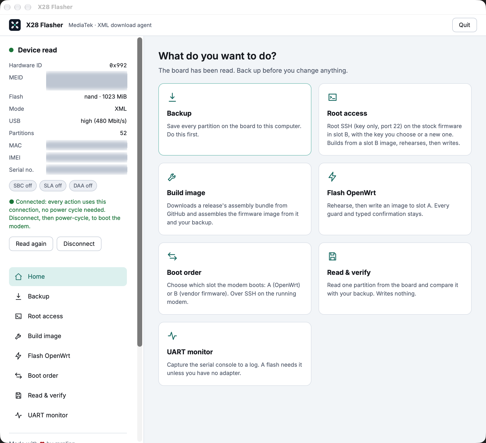

# X28 Flasher manual

Read the warning in the [README](../README.md#warning) first. The firmware side of every step is documented in
[zlt-x28-openwrt `docs/RECOVERY.md`](https://github.com/mralinp/zlt-x28-openwrt/blob/main/docs/RECOVERY.md).



The window has the **device panel** on the left (what the app read from the modem, and Connect / Disconnect), the **steps** under it, and the
selected step on the right. Only one step runs at a time. A running step keeps running when you look at another page.

## What you need

- A **USB cable** to the modem's USB port and the modem on its own power supply. Stable power matters during any write.
- `DA_BR.bin`, the vendor download agent. It is already in the app and in the repo (`tools/x28-flasher/assets/`); you can choose another copy in the app.
- For a write: a **UART adapter** on the modem's debug pins is recommended (its log is kept with the run). Without one the app asks and the way back
  from a failed write is a USB restore from your backup.
- **Docker**, for building an image from your backup and for Root access (the images are assembled in a container). Downloading the signed image needs none.
- On Windows and Linux the app opens in your browser; on a Mac it is a native window.

## Which step, in which order

| Step | What it is for | Writes to the modem? | When |
|---|---|---|---|
| Connect | Finds the modem over USB and reads what it is | no | first, and after every power cycle |
| Backup | Saves every partition to this computer, hash-checked | no | first, always, and keep a second copy |
| Root access | Puts key-only SSH on the stock firmware (slot B) | **yes** (slot B overlay) | once, on a fresh unit, after the Backup |
| Get an image | Downloads a release's signed image, or builds one from a release and your backup | no | before a flash |
| Flash OpenWrt | Writes the image to slot A | **yes** (slot A) | after Build |
| Boot order | Chooses which slot boots next | **yes** (2 bytes x 4 copies) | after a flash, to boot OpenWrt, or to go back to stock |
| Read & verify | Reads one partition and compares it with your backup | no | after every write |
| UART monitor | Records the serial console to a log | no | before a write, if you have an adapter |

## Connect

Power the modem off, wait **10 s**, power it on. The app walks you through it and reads the board (hardware ID, flash, security flags, IMEI,
serial, MAC). The connection then stays open: every following step uses it, so you do **not** power-cycle again between steps. Press
**Disconnect** when you are done, and power-cycle the modem to let it boot normally. If the modem is not found, repeat the sequence; never start a
write on a flaky connection.

## Backup

Reads all partitions over USB, each twice, and checks the hashes. Choose where to keep it. It can be resumed if it stops. This is the way back
from almost any mistake: **keep it, and keep a copy on another disk.**

## Root access

For a **fresh unit that still runs the vendor firmware**. It reads a fresh snapshot of slot B from the modem (proinfo, misc, rootfs_a, rootfs_b and
boot_para, about 130 MiB; rootfs_a is read so the write can prove that slot A stays untouched), builds a key-only SSH image from it, then rehearses
and writes only slot B's overlay tail. You choose an RSA key from `~/.ssh`, or a new pair (`~/.ssh/x28_rsa`) is made. SSH then answers on port 22
(and 2222) with that key. Telnet is deliberately not offered. You type a confirmation phrase yourself. Do it once; the stock slot B keeps SSH after.

## Get an image

Two ways, both ending in the Flash page:

- **Download the signed image** (no Docker): the release's `x28-sysupgrade-<version>.tar`, built by CI. The app checks GitHub's SHA-256, the
  signature (a signer certified by the X28 feed key, which is built into the app, within its validity dates), that the metadata names this board
  (`Tozed,X28`) and release, and the UBI layout; then pads the image to the 64 MiB slot. Anything wrong and nothing is kept.
- **Build from my backup** (Docker): downloads the release's assembly bundle (rootfs, userspace, kernel modules), checks its hashes, and assembles
  the slot image locally with the stock files of your own backup.

## Flash OpenWrt

Writes the built image to **slot A only**; slot B (stock) is locked here. The flow: choose the image and your backup, optionally a **rehearsal** (write
the unit's own original back and compare, to prove the path), tick the risk checklist, then **type the tool's exact phrase**. Every guard stays: the
backup must match this unit, the UART log must be fresh unless you said you have none, and slot A's boot counter is checked. Nothing retries and
nothing reboots the modem by itself. Afterwards run Read & verify.

## Boot order

A switch between **slot A (OpenWrt)** and **slot B (stock)**. Flip it, press **Change boot order**, accept the risk. It works over SSH on the running
modem, so the modem must be up and reachable: the address is found for you (192.168.70.1, then the vendor's 192.168.0.1), or type another, and a root
password if it has one. It saves a copy of the boot partition first and changes two priority bytes in each of its four copies, last copy first, each read
back. It applies at the next power-up; nothing reboots the modem for you.

## Read & verify

Reads one partition by name and compares it with your backup. Run it after every write. It writes nothing.

## UART monitor

Captures the serial console to a log. Start it before a write if you have an adapter; the guarded tools check that the log is fresh.

## The Support box

At the bottom of the sidebar: the project's EVM address with a QR code. Stars and donations are welcome.

## Terminal use

```bash
python3 tools/x28-flasher/x28_flasher.py wizard                 # menu
python3 tools/x28-flasher/x28_flasher.py ports                  # serial ports
python3 tools/x28-flasher/x28_flasher.py uart                   # capture UART (Ctrl-C stops)
python3 tools/x28-flasher/x28_flasher.py read [partition]       # read and compare with the backup
python3 tools/x28-flasher/x28_flasher.py flash identical|write --candidate-dir D [--base-dir D]
```
